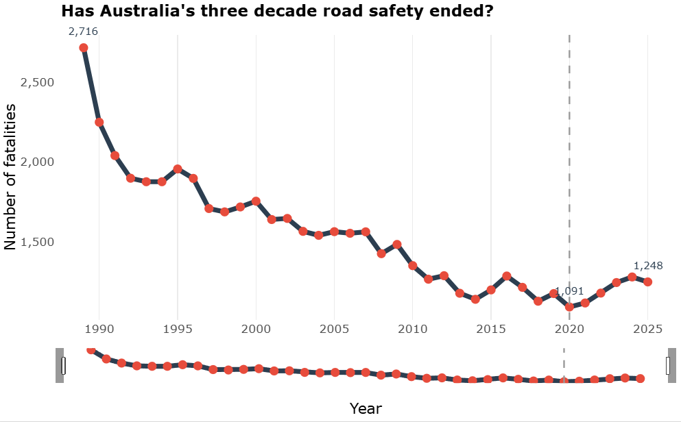
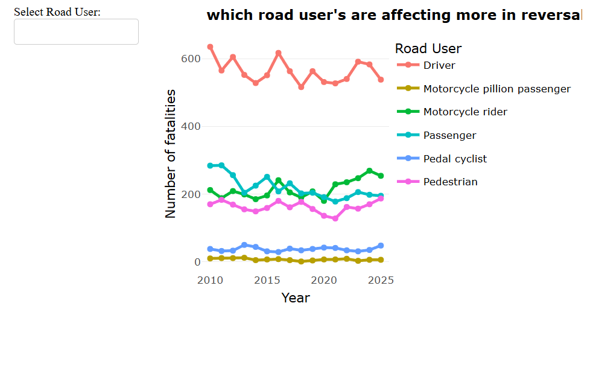
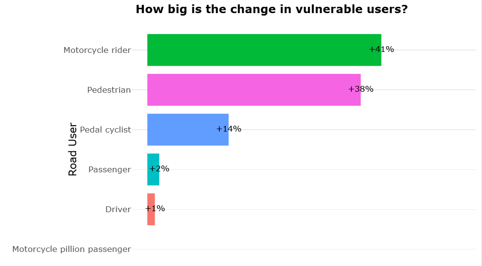
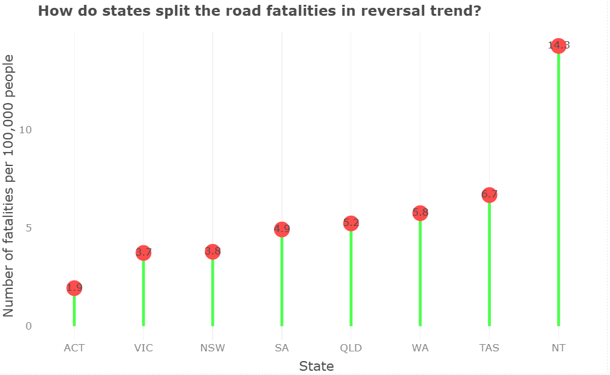
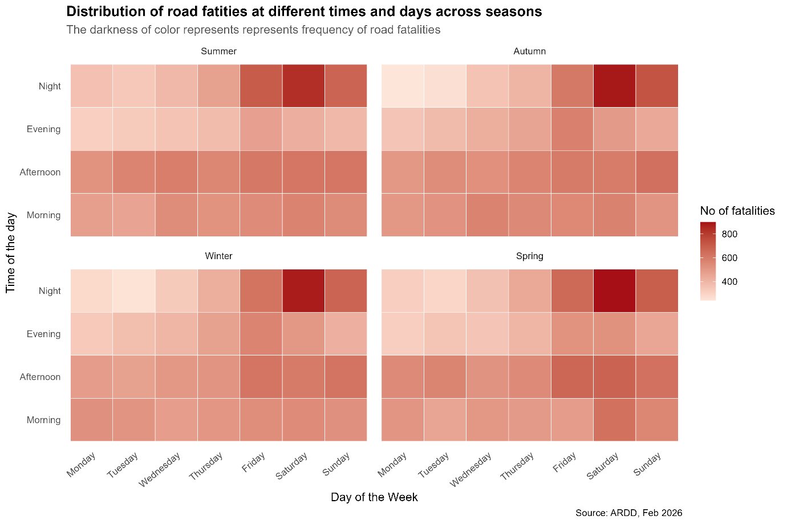
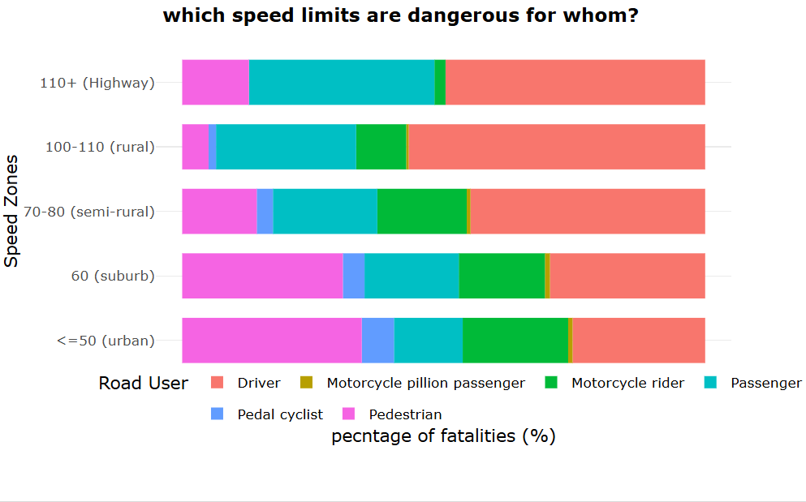
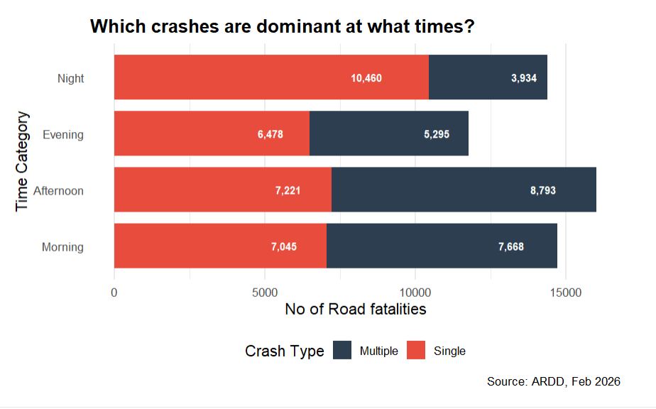
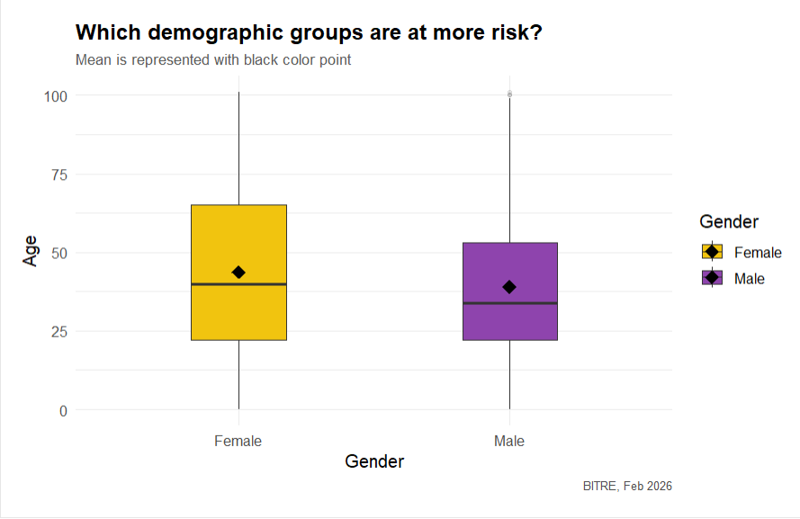
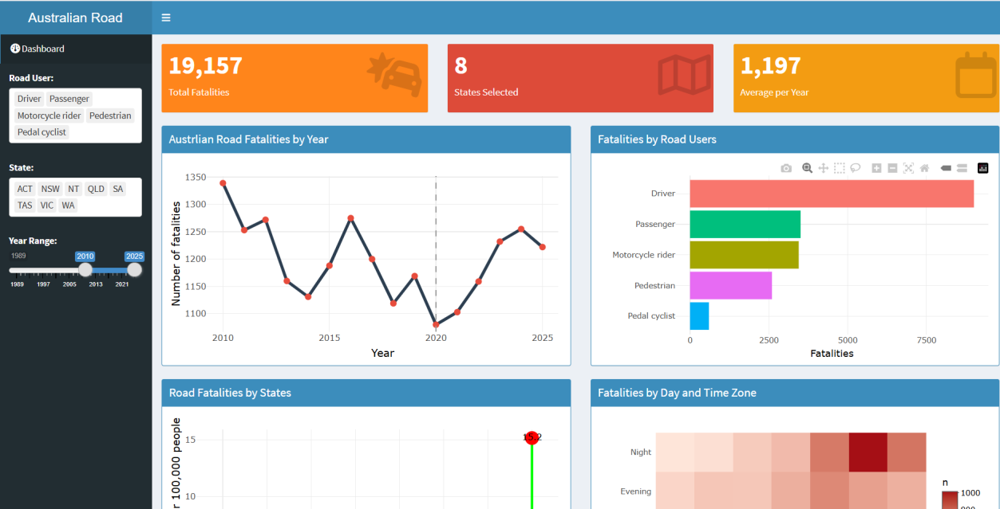

# Has Australia's road safety success ended?

**For 30 years Australia's road deaths fell. Since 2020 they have risen every year. This data story asks who is dying, where, and why.**

R · tidyverse · ggplot2 · plotly · Shiny · Quarto · Data storytelling

**[Live interactive dashboard](https://satish2001.shinyapps.io/road_fatalities_dashboard/)** · [Full data story (PDF)](docs/data_story.pdf) · [Design decisions (PDF)](docs/design_and_construction.pdf) · [Code](R/road_fatalities_story.qmd)

---

## Key findings

| # | Finding |
|---|---|
| 1 | **The trend reversed in 2020.** Road deaths fell from 2,716 in 1989 to 1,091 in 2020, then rose every year to 1,248 in 2025. |
| 2 | **The rise is almost entirely vulnerable road users.** Since 2020, motorcyclist deaths rose about 40%, pedestrians 38% and pedal cyclists 14%, while drivers and passengers together rose 3%. **94% of the increase** came from vulnerable road users. |
| 3 | **Remote states carry the highest risk per person.** The Northern Territory records about 14.3 deaths per 100,000 people, seven times the ACT (1.9) and well above the national 4.3. NSW has the most deaths in raw numbers but is among the safest per person. |
| 4 | **Weekend nights are the most dangerous time to travel,** in every season, and most of all in summer. |
| 5 | **Speed zones affect road users differently.** Pedestrians and cyclists die mostly in low-speed (≤ 50 km/h) urban zones; drivers and passengers take about half of the deaths on 100–110 km/h highways. |
| 6 | **Night deaths are mostly single-vehicle crashes;** mornings and afternoons are dominated by multi-vehicle crashes. |
| 7 | **Young to middle-aged men** are the most affected group. |

**What it means:** Australia's road safety gains were built around people inside vehicles (seatbelts, airbags, ABS, safer cars). The people left behind are those outside them. The next gains will come from low-speed urban zones and weekend nights, where pedestrians, motorcyclists and cyclists are most at risk.

## The story in eight graphics

Each graphic answers one question and raises the next.

| Section | Question | Graphic |
|---|---|---|
| 1. The trend | Has the three-decade success ended? |  |
| | Which road users are driving the reversal? |  |
| | How big is the change for each group? |  |
| 2. When and where | Which states carry the highest risk per person? |  |
| | Which days and times are riskiest, and does it change by season? |  |
| | Which speed zones are dangerous for whom? |  |
| 3. Who | Which crash types dominate at which times? |  |
| | Which age and gender groups are most affected? |  |

## Interactive dashboard

A Shiny dashboard lets anyone filter by road user, state and year range: five linked interactive charts and three live summary boxes.

**[Open the live dashboard](https://satish2001.shinyapps.io/road_fatalities_dashboard/)**

## Design choices

- **One story, not a data dump.** A first draft had ten graphics covering every variable; it was repetitive. It was cut to eight, each of which adds something new, split into three sections (trend, when and where, who).
- **Fair comparisons.** States are compared per 100,000 people, not by raw counts, which mostly reflect population.
- **Focus on the break point.** 2020 is where the trend turned, so later graphics focus on the reversal period rather than all 37 years.
- **Written for the public.** Plain titles phrased as questions, with the answer in the subtitle, so a non-technical reader can follow the story.

## How to run

1. Download the ARDD fatalities file into `data/` (see [`data/README.md`](data/README.md)).
2. Open `australian-road-fatalities.Rproj` in RStudio.
3. Open `R/road_fatalities_story.qmd` and click **Render**.

## Data

Bureau of Infrastructure and Transport Research Economics (BITRE), **Australian Road Deaths Database**, February 2026 release, CC BY 4.0. Every road death in Australia since 1989.

## Limitations

- Death counts aren't adjusted for distance travelled, so busy roads and times show more deaths partly because more people use them.
- The reasons suggested for patterns (visibility, speed, remoteness) are interpretations; the data shows where deaths happen, not why.

## About

Built by **Satish Kumar Reddy Gajjala** for Data Visualisation (MATH X314), Master of Data Science, University of Adelaide.
[LinkedIn](https://www.linkedin.com/in/satish-kumar-reddy-gajjala-450150234/) · [GitHub](https://github.com/satish9346)
